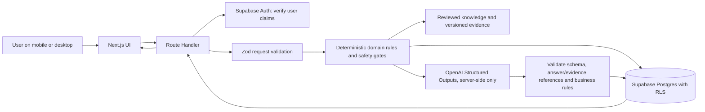

# System Design & Architecture

**Status:** Proposed architecture for the planning baseline (2026-10-24), not deployed or implemented. There were no source files or design exports in RenevaAI when inspected. Review this document alongside `PRODUCT_SPEC.md` and `ROADMAP.md` before implementation.

**Prototype update:** A frontend-only Next.js prototype has now been added. It keeps onboarding, plan, dashboard, check-in and coach state in React memory; it has no API, database, authentication, provider call, browser persistence or telemetry. Recommendations are illustrative deterministic rules, not reviewed evidence or professional advice. This prototype is for visual/flow review and is not the production architecture.

## 1. Architecture goals

- One application and a small number of managed services for the MVP.
- Understand profile/routines first; structured profile is the source of truth, not model memory or chat history.
- Application rules control workflow, required topics, recommendation eligibility and safety; AI assists with interpretation and drafts.
- Make every recommendation traceable to confirmed answers and reviewed evidence.
- Keep data access user-scoped, consented, deletable and minimally logged.
- Separate UI, domain logic, persistence, AI provider, evidence, and authorization for testability and future hosting flexibility.

## 2. Proposed stack and trade-offs

| Layer | Recommendation | Reason / caveat |
|---|---|---|
| Web app | Next.js App Router + TypeScript | Single application can deliver responsive pages and server Route Handlers. There is no existing app implementation to extend. |
| UI | Tailwind CSS + selective shadcn/ui primitives | Fast accessible building blocks without forcing a generic visual style. Apply Figma design tokens when supplied. |
| Forms | React Hook Form + Zod resolver | Progressive, multi-step forms; shared runtime validation on browser/server where appropriate. |
| Backend | Next.js Route Handlers + modular server-only domain services | Avoid a second API service initially; keep pure business logic independent of route implementation. |
| Database/Auth | Supabase Postgres + Auth | Managed Postgres, SSR-compatible auth, migrations and row-level security. Use request-scoped server client and validate claims. |
| Files | Supabase private Storage only if product need approved | No photos/uploads in first milestone. Use owner-scoped policies and consent/retention design before enabling. |
| AI | OpenAI server-side API with Structured Outputs, Zod schemas, configurable model | Schema is not a safety/business-rule guarantee. Validate source IDs, answer references, scope and rules after generation. Handle refusal/incomplete/error states. |
| Tests | Vitest + Playwright + Supabase database/RLS tests | Cover domain, routes, real browser journey and database ownership. |
| CI/hosting | GitHub Actions + Vercel | Simple deployment. Choose function region deliberately alongside Supabase region and data requirements. |

Do not add an agent framework, vector database, queue, separate Python service, or native client unless a validated requirement justifies it. A compact, versioned reviewed-knowledge table/document set is adequate for the dry-hair MVP; add retrieval infrastructure only after measuring need.

## 3. Logical request flow



The AI is an untrusted proposal generator, never the authority for identity, authorization, evidence validity, safety eligibility, or persisted facts. If AI is unavailable, the app may offer a clearly labeled synthetic demo or a deterministic non-AI flow; it must not pretend the result is AI analysis.

## 4. Frontend / backend responsibilities

### Current prototype boundary

- `src/app/page.tsx` is a single client-side flow for fast product review. The minimal landing screen uses “Your goals. Your lifestyle. Your transformation.” and one category-neutral “Begin your journey” CTA, without a hero graphic or sample-plan CTA. The flow continues through four-step onboarding, selectable multi-focus categories, sequential goal-specific follow-up prompts, reported/hypothesis/unknown analysis, dashboard tabs, expandable rationale, completion toggles, feedback-driven preview changes, and a deterministic demo coach.
- Data is in React state only. Refreshing, closing the tab, or navigating away clears it. The sample journey is fictional; no account or persistence exists.
- `src/config/brand.ts` centralizes the working name Revana and its brand story, “Renew your routines. Reveal your potential.” The story is original positioning, not a linguistic etymology claim. Trademark/domain screening and legal clearance have not been completed.
- Skin, body/fitness, energy/lifestyle, and other can be selected to demonstrate discovery prompts and cautious exploratory summaries. They do not provide validated plans, clinical advice, treatment recommendations, or reviewed evidence. Treat those journeys as interaction prototypes only.
- No backend or cloud integration is part of this visual prototype. Do not add Supabase/OpenAI until a production milestone is approved and privacy/auth decisions are reviewed.

### Frontend

- Mobile-first, multi-focus onboarding, progress, save/resume, and explicit answer-state controls.
- Progressive question rendering from server-provided/application-defined relevance rules; hide unrelated categories.
- Begin the journey with a category-neutral CTA. Let users select one or more goals; present concise, goal-specific follow-ups for each in sequence. Keep detailed routine questions category-specific (hair detail only when Hair is selected).
- On small screens, use one focused question group at a time, collapsed optional detail sections, concise labels/help, sticky but non-obstructing primary actions, and safe-area-aware bottom navigation. Avoid making users scroll through irrelevant or optional content; do not hide required safety information merely to shorten a page.
- When navigation changes the visible screen, onboarding step, or dashboard tab, return the viewport to the top with smooth scrolling unless the user requests reduced motion. Keep focus management accessible and avoid scrolling behind fixed headers.
- Establish a consistent type scale: comfortable body text, legible labels and secondary text, and restrained display headings. Avoid both microcopy that is too small and oversized headings that push primary actions below the fold. Use concise copy and progressive disclosure rather than compressing text to fit.
- Test narrow phone widths (320–430 CSS px), landscape where supported, and desktop. Prevent horizontal overflow; maintain touch targets around 44×44 CSS px and ensure fixed navigation does not cover content or keyboard-focused inputs.
- Keep meaning independent of color: pair color with visible text labels/icons/patterns and selected states; verify contrast, focus and reduced-motion preferences.
- Prototype implementation note: onboarding uses a fixed, safe-area-aware action footer on mobile, with optional product/treatment and budget fields collapsed by default. Dashboard navigation moves to a persistent bottom bar. Verify on actual devices with the software keyboard open before treating as complete.
- Clear fact/inference/unknown labeling, source/evidence disclosure, consent, and AI/demonstration labels.
- Plan and recommendation cards with “why this fits,” effort/cost/alternatives, expected review timing, limitations, and safe action tracking.
- Dashboard, feedback/check-in, version review, and chat interfaces.
- Client validation improves UX but is never a security or authorization boundary.
- Do not put OpenAI secret, Supabase service key, or privileged admin capability in browser code.

### Backend

- Authenticate every private request and derive `user_id` from verified auth context, never from untrusted request fields.
- Validate payloads and ownership; use request-scoped Supabase client so database RLS applies.
- Own deterministic question relevance, required topics, completion rules, safety gates, versioning, and plan writes.
- Call OpenAI with minimal necessary context; do not send full history by default. Do not send a service key to AI.
- Validate AI schema and independent domain invariants before returning/saving any result.
- Retrieve only reviewed/active evidence for the relevant concern; return references and version metadata.
- Implement consent, deletion/export, minimal sensitive logging, throttling and bounded retries.

## 5. Proposed source tree (implementation target)

```text
RenevaAI/
  AGENTS.md
  README.md
  docs/
    PRODUCT_SPEC.md
    SYSTEM_ARCHITECTURE.md
    ROADMAP.md
    decisions/                 # short ADRs for material changes
  src/
    app/
      (public)/                # landing/sign-in
      (app)/                   # protected dashboard, onboarding, plan, settings
      api/
        onboarding/route.ts
        onboarding/follow-ups/route.ts
        analysis/route.ts
        plans/route.ts
        check-ins/route.ts
        chat/route.ts
        account/export/route.ts
        account/delete/route.ts
    components/
      ui/                      # reusable accessible primitives
      layout/
      onboarding/
      analysis/
      recommendations/
      dashboard/
    features/
      onboarding/              # questions, answer state, client form composition
      plans/
      check-ins/
      chat/
    lib/
      supabase/                # browser + request-scoped server clients
      auth/                    # verified identity/authorization helpers
      validation/              # Zod API/domain schemas
      domain/                  # pure rules; no React/DB/OpenAI dependency
      services/                # application use cases and persistence orchestration
      ai/                      # provider adapter, prompts, output schemas, version IDs
      knowledge/               # evidence types, reviewed content access
      privacy/                 # consent, retention, deletion/export rules
    types/
  supabase/
    migrations/
    seed.sql                   # fictional/synthetic development content only
    tests/                     # pgTAP RLS/ownership policies
  tests/
    unit/
    integration/
    e2e/
  .github/workflows/           # CI checks
```

The route tree is a proposal, not a commitment to create every endpoint at once. Build modules only as milestones need them. Do not check in `.env.local` or real user fixtures.

## 6. Data model (initial proposal)

All private user-owned rows include a non-null `user_id` referencing `auth.users`. Use UUID primary keys, `created_at`/`updated_at`, indexes on policy filter columns, and explicit foreign keys. RLS enabled and least-privilege grants required for every exposed table.

| Entity | Important fields / ownership |
|---|---|
| `profiles` | `user_id` unique; locale/time zone and minimal preferences; avoid unnecessary demographics. |
| `consents` | `user_id`, consent type/version, granted/withdrawn timestamps; immutable history where legally appropriate. |
| `onboarding_sessions` | `user_id`, status, current step, target date/mode, saved progress. |
| `goals` | `user_id`, category, description, priority, goal horizon/event type. |
| `profile_answers` | `user_id`, session/profile reference, topic/key, typed value, state (`confirmed`/`skipped`/`unanswered`), provenance, confirmation timestamp. Do not encode skipped as false/null alone. |
| `products` | `user_id`, category, user-provided product name/ingredient text, use frequency, reaction notes; text is untrusted. No mandatory brand tracking. |
| `evidence_sources` | Curated source identity, publisher, title, URL/identifier, publication/review date, scope, claims/limitations, locale, active/version. Admin-managed; never user-editable. |
| `plans` | `user_id`, version, status, profile/answer snapshot reference, prompt/rule/knowledge versions, created/review date. Use revisions, don't silently overwrite. |
| `plan_recommendations` | `user_id`, plan ID/version, action, rationale, linked answer IDs, evidence IDs, expected outcome/time, effort/cost, risk/limits, priority, review timing, status. |
| `actions` | `user_id`, recommendation ID, scheduled date/cadence, completion state, notes limited/minimized. |
| `check_ins` | `user_id`, plan version, relevant questions/answers, adherence, perceived response, barriers, adverse reaction/concern flag. |
| `chat_sessions` | `user_id`, active plan/profile references, created/expiry metadata; persist transcripts only after explicit retention decision. MVP default: do not persist chat messages. |

### Ownership rules

- RLS policies for `SELECT`, `INSERT`, `UPDATE`, and `DELETE` explicitly target `authenticated`, require `auth.uid()` to match `user_id`, and constrain both existing and resulting rows as applicable.
- Revoke unnecessary grants as well as writing policies; policies alone do not remove table privileges. Test each table policy with a user and a different authenticated user.
- Server-side admin/service-role keys, if ever needed, bypass RLS and stay server-only; minimize their use. Never trust `user_metadata` as an authorization source.
- For private Storage, object paths include the authenticated user ID and policies restrict each operation. Prefer short-lived signed URLs only after access checks. No public buckets for sensitive images.
- Keep health/appearance data out of analytics and routine logs. Define deletion behavior across rows, files, backups and provider retention before launch; disclose limits.

## 7. Onboarding and question logic

Store answers as structured rows and a state enum; derive completion from deterministic rules, not the model. A question registry maps `question_id` to category/topic, applicability predicate, sensitivity classification, required/optional status, and downstream dependencies. A question can be asked only if relevant, not already confirmed, and not marked as intentionally skipped unless the user reopens it.

Proposed flow:

1. Goal and free-text concern; allow “other” and multi-category.
2. Deadline mode: exact date, approximate timeframe, none; distinguish event from ongoing goal. Calculate remaining days server-side using the user’s time zone and clarify feasibility without promising outcomes.
3. Clarify experienced concern: when, what, how long, changes, prior attempts, perceived factors.
4. Reconstruct relevant habits/routine and barriers.
5. Existing products/treatments and preferences (time, budget, effort, at-home/professional mix).
6. Contextual safety questions only when relevant; allow skip and record that absence limits guidance.
7. Review reported answers; explicitly request confirmation before material inferred profile changes.
8. Analysis shows facts/hypotheses/gaps. Ask a follow-up only when missing information materially changes a safe recommendation.

For MVP, implement only dry-hair branch. Ask dryness location/timing, wash cadence, shampoo/conditioner/mask/leave-in, heat/dye/bleach, routine changes, breakage/shedding where relevant, reactions, budget/time, and preference. No mandatory skin, fitness, nutrition or medical questionnaire.

## 8. Recommendation policy and evidence

Represent each recommendation as structured domain data:

- `recommendation_type` and category allowlist;
- plain-language action and instructions;
- `why_for_user` with IDs of confirmed answers (not inferred facts presented as confirmed);
- reviewed evidence IDs and relevant supported claim/limitations;
- expected outcome and reasonable observation window, with uncertainty;
- frequency/dose only when appropriate and evidence reviewed (no supplement dosing in MVP);
- effort, estimated cost band/source date if supplied, and at-home/professional preference match;
- risk, contraindications, safety-gate result, and escalation guidance;
- `review_at`/feedback indicators and recommendation version.

Ranking is deterministic and explainable: safety eligibility first; then relevance, evidence strength, likely benefit, practicality, user preference, effort and cost. The model may propose candidates and narratives but cannot set a safety pass, invent source IDs, override user constraints, or persist unconfirmed material inference. The plan should begin with a few useful steps, not a maximal routine.

Knowledge sources require named reviewer/role, provenance, locale, date reviewed, version, scope, limitations and a re-review date. Do not publish model-generated references without lookup against this reviewed set. Keep common claims separate from sourced claims, and say when evidence is limited. Product label/user-upload text is untrusted and cannot establish efficacy or safety.

## 9. AI boundaries and failure behavior

- Define separate small tasks/schemas: follow-up proposal, fact/inference summary, recommendation draft, check-in adjustment proposal. Do not build one giant prompt or depend on model memory.
- Input includes minimum necessary confirmed profile fields, relevant unanswered/skipped status, selected plan, and only reviewed evidence snippets/IDs. Include an explicit instruction to treat quoted user/product text as data.
- Validate Zod output and then application invariants: allowed category, answer IDs belong to user/profile, source IDs active/reviewed, non-prohibited advice, no omitted uncertainty/safety fields, achievable timing, and preference compatibility.
- Persist the draft only after validation and user review. AI-inferred profile updates are separately proposed and require confirmation when material.
- Handle provider refusal, empty/malformed output, unsupported model/schema, timeout, rate limit, network error, and incomplete response. Show a clear non-blaming recovery path; bounded retry only for transient errors, never silently fabricate/fall back to a confident plan.
- Demonstration mode uses fictional profiles and deterministic named rules; visibly label it “Demonstration—synthetic example, not personalized advice.” Never mix demo state with real saved profile.
- Configure provider/model per deployment. API key in server environment only; avoid logging prompt/output. Confirm provider retention/training settings and processor terms before real health/appearance data.

## 10. Proposed API contracts

All private endpoints require verified user identity. Payloads use versioned Zod schemas. Return stable error codes and request IDs without sensitive payloads. The server derives ownership from auth, not payload user IDs.

| Method/path | Purpose | Contract outline |
|---|---|---|
| `GET /api/onboarding` | Resume current draft | Returns user-owned session, answer values/states, applicable next question IDs and schema version. |
| `PUT /api/onboarding` | Save draft/answers | Accepts answer upserts with question ID, value and explicit state; validates applicability and ownership. Idempotent per answer key. |
| `POST /api/onboarding/follow-ups` | Ask targeted questions | Receives current goal/answer IDs; deterministic relevance filter; AI may propose candidates; server filters out answered/irrelevant questions. |
| `POST /api/analysis` | Build analysis summary | Returns reported facts, hypotheses with confidence/answer provenance, missing/uncertain topics, and allowed follow-up questions. No plan write. |
| `POST /api/plans` | Generate a reviewed draft | Returns plan draft with recommendation/evidence/answer references and validation outcome; only save/activate after user confirmation. |
| `GET /api/plans/current` | Load current plan | Returns current user plan/version and actions; no cross-user identifiers. |
| `POST /api/actions` | Update action state | Accepts action ID/state/date; owner check and idempotency. |
| `POST /api/check-ins` | Record focused feedback | Accepts relevant feedback/concern; returns optional adjustment proposal requiring review. |
| `POST /api/chat` | Grounded coach response | Input current message, active plan/profile references; server loads authorized context and returns answer plus linked plan/evidence references. Do not trust client-sent profile as authoritative. |
| `GET /api/account/export` | Export user data | Authenticated, scoped export with explicit content/retention rules. |
| `DELETE /api/account` | Delete account data | Confirmed user action; documented dependent-row/file/provider-retention behavior. |

The exact contracts should be written as shared TypeScript/Zod schemas before frontend/backend integration. Return `401` unauthenticated, `403` unauthorized, `422` invalid or inapplicable input, `429` rate limited, and a safe `5xx`/provider failure response. Never return raw provider secrets or stack traces.

## 11. Security, privacy and observability

- Require HTTPS in hosted environments; secure, HttpOnly, SameSite session cookies; verify auth claims on server-side protected paths and route handlers. Avoid shared caching of authenticated responses.
- Use the Supabase SSR package with browser and request-scoped server clients; keep credentials and admin keys server-only.
- Apply rate limits and request size bounds to AI endpoints. Avoid storing sensitive prompts in application logs, traces, analytics, error reports or support tools.
- Separate account identity from analytics; use minimal aggregate events only after consent/assessment. Never include raw text, product labels, health answers, photos, API keys or model context in event payloads.
- Provide account data export/deletion and consent withdrawal. Make consent version/purpose explicit. Define retention periods before launch and test deletion propagation.
- If images are added later, specify encryption, region, access audit, signed URL TTL, metadata stripping, upload validation, retention/deletion, and prohibition on external vision analysis without separate consent.
- Threat model prompt injection, cross-user access, IDOR, session fixation/theft, insecure direct object references, secret exposure, SSR/CDN caching, overlong text, replay, and deletion gaps.

## 12. Environment, deployment and setup

No accounts, secrets, cloud resources, runtime, package manager, dependencies, or deployment are configured in this folder. Proposed environment variables for later setup:

| Variable | Exposure | Purpose |
|---|---|---|
| `NEXT_PUBLIC_SUPABASE_URL` | Public | Supabase project URL. |
| `NEXT_PUBLIC_SUPABASE_PUBLISHABLE_KEY` | Public | Supabase publishable key; database RLS remains mandatory. |
| `OPENAI_API_KEY` | Server only | Provider credential; never `NEXT_PUBLIC_*`. |
| `OPENAI_MODEL` | Server only | Model identifier, validated against project account capability. |
| `APP_NAME` | Public/configurable | Temporary configurable brand. |
| `NEXT_PUBLIC_APP_URL` | Public | Canonical app origin used for links/auth callbacks. |
| `DEFAULT_LOCALE` | Public/configurable | Initially proposed `en`; confirm region/language. |
| `DATA_REGION` | Deployment metadata | Document chosen Vercel/Supabase region; not a secret. |

Use separate local/preview/production Supabase projects and credentials; synthetic seed records only. Add `.env.example` with placeholders, ensure local env files are ignored, and document Supabase migration/seed/test commands after selecting the toolchain. Configure Vercel Function region near the database and verify provider processing/data residency expectations; Vercel's default region is not a residency guarantee. No deploy until auth/RLS, privacy disclosures, secrets, and region decisions are reviewed.

## 13. Verification strategy

- **Domain unit tests:** applicability predicates, completed/skipped/unanswered state, date/timezone boundary, priority rules, safety gates, evidence/source validation, and plan versioning.
- **AI contract tests:** valid, refused, incomplete, timed out, malformed, schema-valid but business-invalid, wrong-user answer/source IDs, prompt injection in product text, prohibited supplement/diagnosis output.
- **API/integration:** authentication, validation, ownership derived from claims, idempotency, error redaction, consent checks, and deletion/export.
- **Database:** pgTAP or equivalent RLS tests for every table and operation with user A/user B, including attempted reassignment of `user_id`; test grants as well as policies.
- **E2E:** user signs in, starts dry-hair onboarding, skips a safety field, resumes, receives a constrained plan, opens rationale, completes an action, reports irritation/no benefit, reviews proposed change and accepts/rejects it.
- **Contrasting synthetic profiles:** frequent harsh cleansing/high heat/no conditioner vs. low heat/conditioning and a different concern; plans and reasons must differ. A low-budget/low-time profile must get suitable alternatives.
- **Safety/privacy:** no advice beyond approved scope with missing safety answers; adverse reaction escalation; user A cannot view or mutate B's answers/plans/chat/files; deletion removes accessible records; secret scan and logs contain no sensitive sample text.
- **Quality bar:** tests and accessibility checks in CI; a real provider call is opt-in and never required for deterministic test runs.

## 14. Assumptions / decisions required

See decision log in `PRODUCT_SPEC.md`. Before live sensitive data: confirm launch countries/languages, age policy, data controller and processor roles, provider/model and data handling, region/residency, AI consent language, retention/deletion behavior, evidence review ownership, medical escalation copy, and user/account support processes. Figma/export is missing and blocks visual-parity work.
